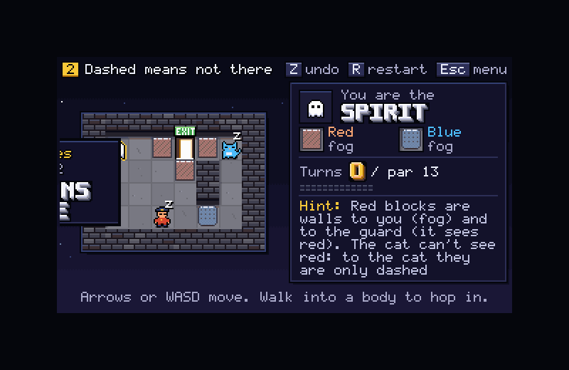

# Game Off 2026 — theme: SHIFT

Solo entry for [GitHub Game Off 2026](https://itch.io/jam/game-off-2026) (theme **SHIFT**, due 1 Dec 2026): **Body Hop**, a turn-based browser puzzle game in plain HTML and JavaScript.

You are a spirit that hops between the bodies in a building. Each body sees one colour, and only what it sees is real. Bodies you leave behind stay where they are and get in the way, so the puzzle is where to leave each one. One verb, the hop, shifts who you are and what the world contains.

**Play:** [vladimirli.github.io/game-off-2026](https://vladimirli.github.io/game-off-2026/), or open `game/index.html` locally.

## Status

Complete and playable; the jam deadline is Tue 1 Dec 2026, 21:37 UTC.

- 18 levels: 12 main levels and the optional Night shift chapter (X1 to X6), each checked by the solver.
- Title and end screens, a pixel-art in-game UI (keyboard, touch pad and tall phone layouts) and juice polish: eased walks, hop take-off, board bump on a refused press, win confetti, `prefers-reduced-motion` respected.
- Sound is in: effects generated in code and a calm generative music track that shifts with the body you are in.
- Art is in: 8-bit pixel art and animation drawn in code; each body repaints the room in its colour.
- Tested by AI personas only; no human playtest yet. Their logs and two early research notes were deleted from the repo; they are in git history before this commit (4815b55).

## Layout

| Path | What |
|---|---|
| `game/` | The game: `index.html` and seven scripts. Open `game/index.html`, or play it online |
| `tools/` | Solver, browser bot, level tools and the GIF and screenshot recorders (Node.js) |
| `docs/` | Rules, controls and levels (`GAME.md`), level-design spec, itch.io page text, tester guide, research notes |
| `media/` | The README GIF and the itch.io screenshots |
| `.claude/` | Claude Code agents, hooks and checks used to build and test the game |

## Tooling

- Node.js for the checks, run from the repo root: `node tools/solve.js` (every level solvable at par) and `node tools/bot.js` (replays each solution as key presses in Chromium; needs `npm install` once).

## AI disclosure

Body Hop was made with Claude (Anthropic) under my direction. Claude wrote the code, including the pixel art and the music and sound effects, which are all generated in code. It also designed the levels (checked by a solver) and did the research. I reviewed and approved the art, sound and screens; playtesting so far was done by AI personas, and no outside human has played it yet. Sound effects use ZzFX (MIT).

## Licence

MIT, see [LICENSE](LICENSE). The ZzFX sound code in `game/audio.js` keeps its own MIT notice.
